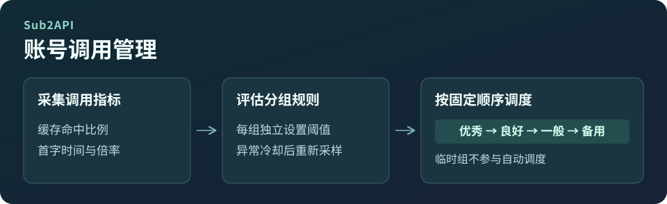
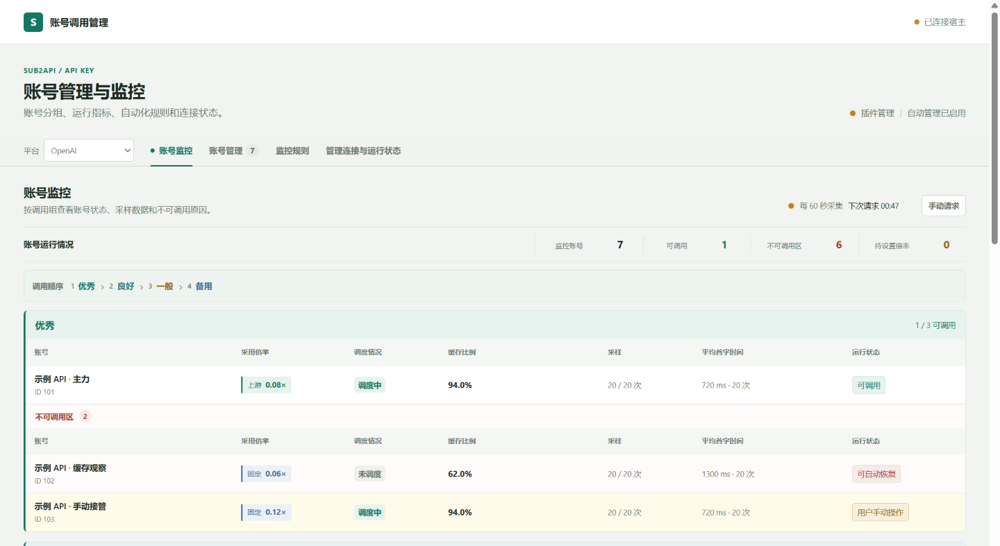

# sub2api-scheduling-plugin

**让 Sub2API API Key 账号调度更清晰、更可控。**

这是一个通过 Sub2API 插件接口运行的账号调度管理插件。它依据近期调用表现和账号倍率，帮助你整理账号的调用顺序、控制参与调度的账号，并在账号进入异常或发生人工修改时提供明确的状态与保护。无需修改 Sub2API 宿主源码。

宿主中的插件名称为 **账号调用管理**。本项目面向希望按平台和调用组管理 API Key 账号的 Sub2API 用户；它只管理插件中明确添加的账号，不会自动接管宿主内的全部账号。



## 项目概览

账号多了以后，逐个查看缓存、首字时间、倍率和调度开关很难快速判断当前由谁参与调用。本插件把这些信息集中到一个管理界面，并按预先设置的分组顺序维护账号调度：优秀组优先，其次是良好、一般和备用；临时组用于暂存账号，不参与自动调用。

插件从 Sub2API 管理 API 读取账号、用量和可用的上游倍率快照，并把账号调度状态、优先级及需要恢复的信息交给宿主 API 和插件 KV 处理。监控采样在用户开启自动管理后开始；用户可以先配置连接、账号、倍率和规则，再决定何时启用调度管理。

## 运行示意

账号监控按调用组展示调度情况、采样指标和不可调用原因。下图使用本地模拟宿主与演示账号，展示正常调度、异常恢复和用户手动操作状态。



## 主要功能

- **按平台与调用组管理：** 不同平台分别管理。四个参与调用的组按固定顺序执行：优秀、良好、一般、备用。默认优先级为 `6`、`7`、`8`、`9`，可按平台调整优先级但不能改变组顺序。临时组优先级为 `99`，不参与自动调用；新添加的账号默认进入临时组。
- **倍率来源明确：** 每个账号可使用上游快照倍率或固定倍率。新账号默认采用上游方案；上游不支持或读取不到时使用默认 `1.0×`，界面会注明倍率来源，不会自动切换成账号保存的固定倍率。
- **分组异常规则：** 每个调用组分别设置缓存命中比例下限、平均首字时间上限和有效倍率上限。默认缓存下限为 `80%`、首字时间上限为 `10,000 ms`、倍率上限为 `0.2×`。优秀组可另外启用倍率独占筛选。
- **异常与恢复状态：** 达到异常规则的账号暂停参与调用，进入该组的不可调用区域；可恢复的账号在冷却后重新采样并参与组内选择。监控界面可以查看调度情况、采样指标、不可调用原因和恢复安排。
- **尊重人工操作：** 插件记录自己接管的宿主设置。检测到人工修改后会停止覆盖该账号，并保留宿主当前状态。关闭自动管理时，插件按所有权记录恢复其接管的设置。
- **集中查看与操作：** 提供管理 API 连接诊断、手动采集、独立运行详情窗口和分页操作记录。管理对象仅限明确添加的 API Key 账号。

## 正式插件包安装

普通使用者安装发行版提供的已编译签名包 `.s2plugin`，不需要安装 Go 或自行编译。请从项目发行渠道下载同一版本的插件包和 `trusted-publisher.yaml`。

### 1. 在宿主配置中信任发布者

将发行版 `trusted-publisher.yaml` 中的发布者条目合并到 Sub2API 主配置 `config.yaml` 的 `plugins` 节点。配置结构如下，实际的 `key-id` 和 Base64 公钥以发行附件为准：

```yaml
plugins:
  allow_unsigned: false
  trusted_publishers:
    "<key-id>": "<Base64 发布者公钥>"
```

如果 `config.yaml` 已有 `plugins` 或 `trusted_publishers`，只合并发行者条目并保留现有设置。不要把私钥写入宿主配置，也不要关闭签名校验。保存后按部署方式重启或重新加载 Sub2API。

### 2. 上传并启用插件

在 Sub2API 插件管理页面上传 `sub2api-scheduling-plugin-<版本>.s2plugin`，检查签名发布者与刚才配置的公钥一致，再按宿主提示启用插件。

当前清单的 `tested_sub2api_versions` 为空，尚未声明在真实宿主版本上完成安装验收。若宿主提示版本未验证，请先评估再确认启用。

### 3. 配置管理 API 和账号

在插件的“管理连接与运行状态”页面填写管理 API 地址及“管理 API 密钥”并保存。**这个管理 API 密钥与 `config.yaml` 中用于验证签名的发布者公钥不同。** 它用于读取账号、用量和倍率信息，以及更新账号的调度设置。

保持自动管理关闭，先确认连接正常，再在“账号管理”中添加 API Key 账号 ID、检查账号信息并设置倍率方案。需要参与调用的账号应从临时组移入优秀、良好、一般或备用组，并保存相应规则。配置 Docker 地址与密钥权限时，参阅[使用指南](docs/USER_GUIDE.md)。

确认只有一个预期的执行节点负责管理后，再启用自动管理。随后在“账号监控”中检查各组的调度情况、采样状态和不可调用原因。

卸载前先关闭自动管理，等待插件恢复它接管的宿主设置，再从宿主插件管理页面移除插件。

## 兼容范围

| 项目 | 支持范围 |
| --- | --- |
| Sub2API | `>=0.2.23 <0.3.0`，推荐 `0.2.23` |
| 插件协议 | 版本 `1` |
| 出站传输 API | 版本 `1` |
| UI Bridge | 版本 `1` |
| 自动管理账号 | API Key |

协议测试、本地 UI 测试和宿主源码接口检查不等同于真实部署验收。使用前请核对当前发行版的兼容提示，并先在可控环境中验证。

## 适用范围

本插件管理 API Key 账号的倍率、分组、采样和宿主调度开关。当前版本不自动管理 OAuth 账号，不负责开启宿主上游倍率探测，也不提供账号余额、当天费用或重置宿主限流状态等功能。完整的指标口径、权限要求、Docker 地址示例和状态恢复说明见[使用指南](docs/USER_GUIDE.md)。

## 文档

- [使用指南](docs/USER_GUIDE.md)
- [更新记录](CHANGELOG.md)
- [实现规格](SPEC.md)
- [构建、签名与发行说明](PACKAGING.md)

## 反馈与贡献

欢迎提交问题和改进建议。请提供插件版本、Sub2API 版本、运行环境、复现步骤和脱敏后的错误信息。请勿公开管理 API 密钥、API Key、真实账号标识或内部服务地址。

联系 QQ：**3276645278**

## 许可证

本项目采用 [GNU Lesser General Public License v3.0 only](LICENSE)，SPDX 标识为 `LGPL-3.0-only`。仓库中的 `HOST_PROTOCOL_LICENSE` 保留了宿主插件协议代码对应的许可文本。
